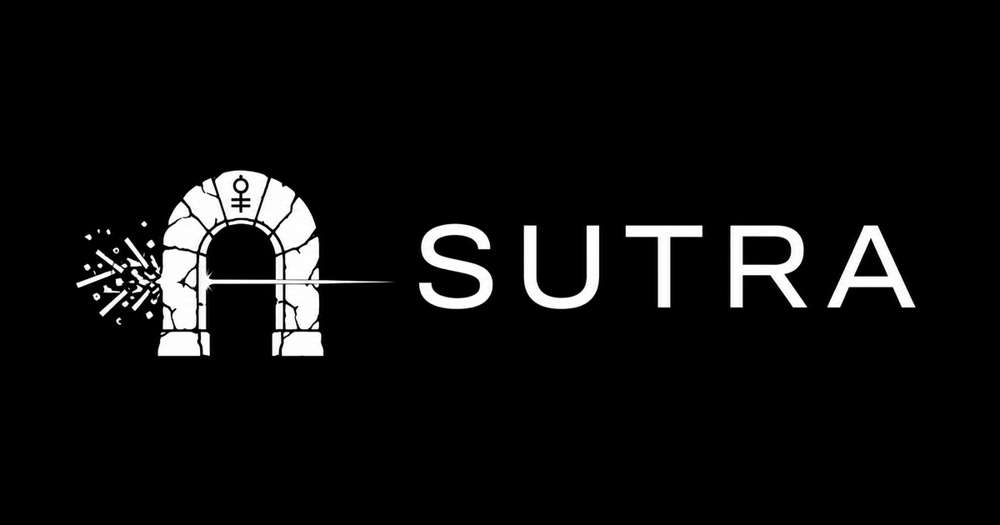

<p align="center">
  
</p>

# SUTRA

**A stone gate for the context window.**

Your agent does not need the whole 2 MB log. It needs the failing line, the stack frame, the row that matters — and a way back to everything else.

SUTRA is a [Hermes Agent](https://hermes-agent.nousresearch.com) plugin that cuts tool output before the model reads it. It removes bytes, names every removal, and keeps the original in a bounded local store — one `sutra_restore` call away.

> **54.3%** fewer bytes · **55.2%** fewer o200k tokens · **8/8** planted clues recovered · **0** diffs touched
>
> Eight generated tool-output shapes. The token column is a `tiktoken o200k_base` count on the payload text, not a provider bill. [Method and limits](https://github.com/g0GobliN/sutra/blob/main/docs/benchmark.md).

## The cost is not the result

A tool result is read once. Then it is read on every turn that follows.

A 2 MB log is not a 2 MB problem. It is 2 MB now, and again in every later context. Compressing the model's replies attacks the small number. Tool output is the part that grows without limit.

Measured on one seven-agent Hermes fleet over two days:

```text
input tokens          16,330,829
output tokens          3,258,687
cache-read tokens    486,503,074     ← 96.8% of all tokens
```

Nearly every token was context being re-read. SUTRA cuts the part that is re-read — and keeps a receipt for what it removed.

## It omits. It does not invent.

One ordered pass. Six rules of restraint.

- **Diffs stay byte-identical.** A rewritten patch can hide a code change. The 600 KB patch fixture saves 0.0% — deliberately.
- **JSON keeps its shape.** Arrays stay arrays. Objects keep their keys. Documents are decoded and re-encoded, never cut at a byte offset that lands inside an escape.
- **The error end survives.** A traceback keeps its tail, where the exception lives. The middle is what gets elided.
- **No model in the loop.** No summarising, no rewriting, no invented content. Deterministic rules. Any unexpected shape fails open to the original result.
- **Bounded and local.** Defaults: 128 MiB store, 32 MiB per entry, 2,000 entries, 168 hours. Directory 0700, files 0600, atomic writes, no symlink following.
- **A receipt, not a summary.** The marker carries an id and the exact restore call, so the model can question the compression instead of trusting it.

## The marker is the contract

Every removal is named: how many bytes, where they were, which id holds them, how long they are retained, and the exact call to get them back. If nothing was retained, the marker says that too.

`sutra_restore` returns bytes, lines, a literal search, or the full original. An optional JSON pointer scopes the request to one field. Pages are 8 KiB by default and concatenate byte-exactly.

## Put it on the tool path

SUTRA ships today as a Hermes Agent plugin. It runs on the tool path, not as a proxy. The work it does — cut, label, retain — does not assume one host.

Current release: [v0.2.0](https://github.com/g0GobliN/sutra/releases/tag/v0.2.0). Verified against Hermes Agent `v0.22.2+3030.g4d04303`.

[Source](https://github.com/g0GobliN/sutra) · [Install](https://github.com/g0GobliN/sutra#install) · [Benchmark](https://github.com/g0GobliN/sutra/blob/main/docs/benchmark.md) · [Recovery protocol](https://github.com/g0GobliN/sutra/blob/main/docs/recovery.md)

## What this does not claim

The numbers measure bytes and tokens, not task success or provider spend. No live model was called for the compression or retrieval results. **8/8** means the clue was retrievable, not that an agent asked for it. The token column is a tokenizer count, not a bill.

MIT licensed.
